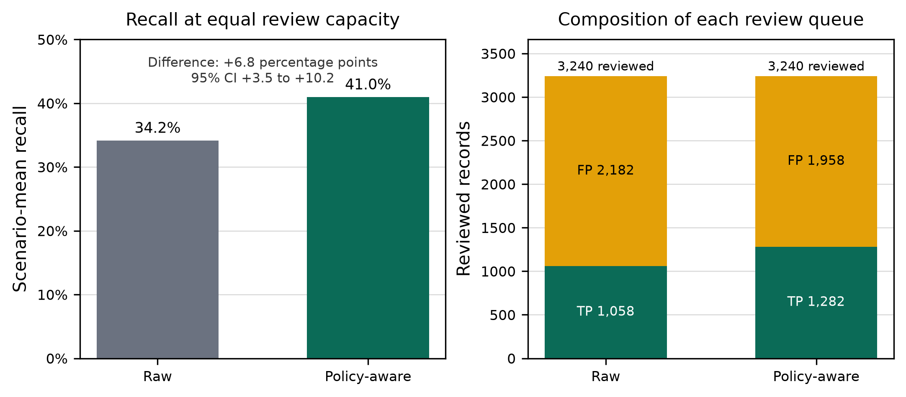
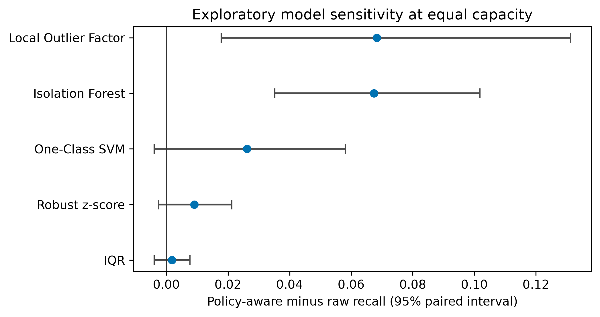
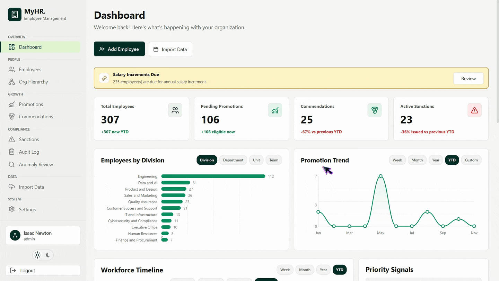
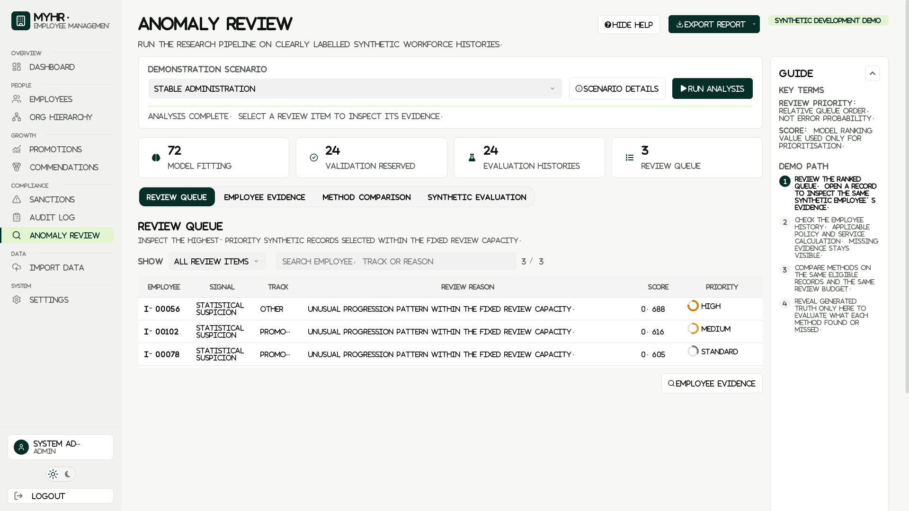
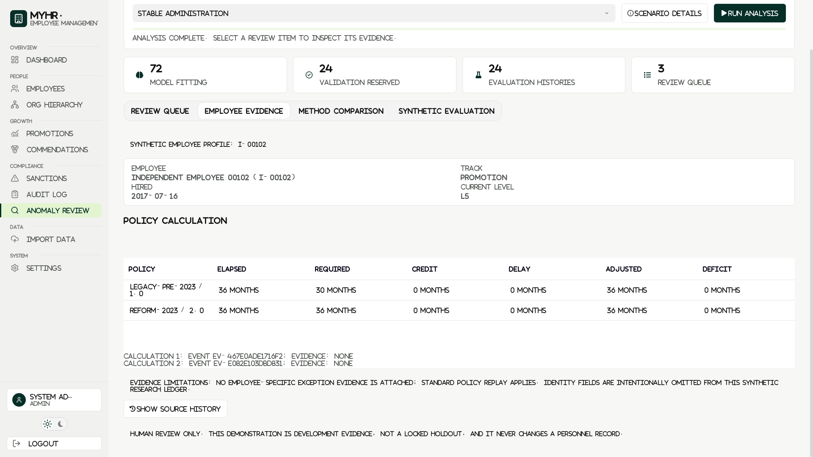
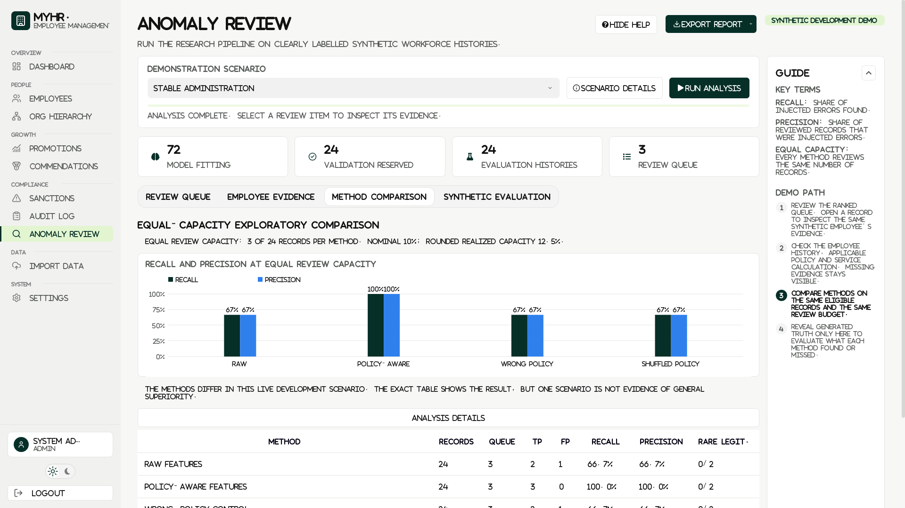
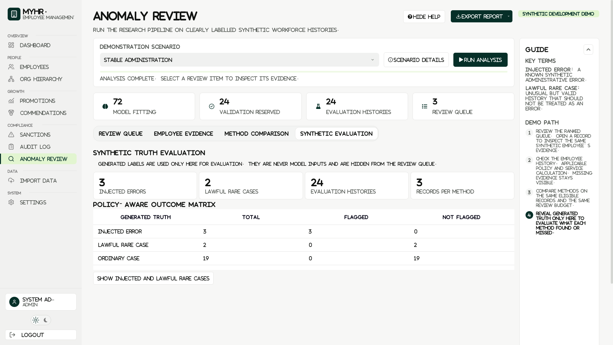

# MyHR: Policy-Aware Anomaly Detection

MyHR is an offline employee-management application built with Python, PySide6,
SQLite, and SQLAlchemy. This branch contains the BME VIK TDK research extension:
policy-aware anomaly detection for workforce progression records.

The research asks whether adding the applicable promotion policy to an anomaly
detector improves the ranking of administrative errors at a fixed HR review
capacity, without unnecessarily flagging unusual but lawful histories.

## Research Result

The frozen synthetic holdout was evaluated once and independently audited. It
contains 1,080 scenarios from 36 conditions and 30 seeds, with 25,920 eligible
evaluation histories.

| Question | Result |
| --- | --- |
| Does policy context improve recall? | **Yes in this synthetic holdout.** Scenario-mean recall increased from 34.2% to 41.0%. The paired difference was +6.81 percentage points (95% CI +3.54 to +10.23, sign-flip p approximately 0.000010). |
| Does the result persist under changed conditions? | **Descriptively yes.** Policy-aware recall was higher in all 19 predeclared policy, population, anomaly-mechanism, rare-pattern, and rate slices. These slice results are robustness diagnostics, not separate confirmatory tests. |
| Are rare lawful cases flagged less often? | **Not conclusively.** The difference was -0.88 percentage points (95% CI -3.33 to +1.53, Holm-adjusted p = 0.199). The pooled counts were 229/2,160 for policy-aware ML and 248/2,160 for raw ML. |



Average precision improved by 6.64 percentage points and the ordinary-clean
flagged rate decreased by 1.02 percentage points; both secondary results remain
significant after the predeclared Holm adjustment. Wrong-policy, shuffled-policy,
ablation, and multi-model controls are reported alongside the primary result.



The conclusion is deliberately narrow: policy-conditioned features helped on
the frozen synthetic design. This does not establish transfer to real employee
data, prove that every gain was caused by correct policy knowledge, or justify
automatic personnel decisions.

Full counts, intervals, tables, and evidence boundaries are in the
[holdout result report](docs/results/TDK_HOLDOUT_RESULTS.md).

## Working Demonstration

The research pipeline also runs inside the desktop application. Open
**Anomaly Review**, choose a synthetic scenario, and select **Run analysis**.
The application uses the same research services as the experiment.



| View | What it shows |
| --- | --- |
| Review Queue | Ranked deterministic findings and statistical suspicions for human review |
| Employee Evidence | Source history, applicable policy version, elapsed service, credits, delays, and deficits |
| Method Comparison | Raw, policy-aware, wrong-policy, and shuffled-policy methods at equal capacity |
| Synthetic Evaluation | Injected errors and lawful rare cases, separated from model inputs |

Anomaly scores never modify personnel records. Generated truth is used only for
synthetic evaluation and is not supplied to the models.

| Review queue | Employee evidence |
| --- | --- |
|  |  |
| **Method comparison** | **Synthetic evaluation** |
|  |  |

## Method

1. Deterministic checks identify invariant contradictions and preserve their evidence.
2. Raw and policy-aware methods receive the same remaining records.
3. Models are fitted on training histories and threshold choices use validation histories.
4. Both methods review the same number of evaluation records.
5. Scenario seeds are the paired statistical units.
6. Wrong-policy, shuffled-policy, ablation, and alternative-model controls test attribution and sensitivity.
7. Every artifact records configuration, dependencies, seeds, source revision, and checksums.

The primary model is Isolation Forest. IQR, Local Outlier Factor, One-Class SVM,
and robust z-score results are exploratory sensitivity analyses. Duplicate-record
detection is implemented and evaluated as a separate task.

## Limitations

- The final evaluation uses synthetic administrative histories, not private employee data.
- Qualitative expert feedback supported continuing the study, but no case-level realism ratings or agreement statistic were collected.
- The rare-legitimate false-alert reduction was not statistically established.
- Robustness slices were descriptively consistent but were not individual confirmatory hypotheses.
- The optional explanation usability study was not conducted.
- Results support human review only, never automated promotion, sanction, salary, or record-merging decisions.

## Run It

```powershell
pip install -r requirements.txt -r requirements-research.txt
python scripts/seed_demo_company.py
python main.py
```

For the local demonstration database, sign in with `admin` / `admin123`. Open
**Employees** to inspect the fictional company, then open **Anomaly Review**.

Verification:

```powershell
python -m pytest tests
python scripts/verify_anomaly_demo.py
python scripts/verify_tdk_citations.py --require-local-artifact
python scripts/audit_tdk_protocol_artifact.py <artifact-directory> `
  --repo-root <frozen-worktree> `
  --holdout-authorization <external-authorization> `
  --holdout-ledger <external-ledger>
python scripts/build_tdk_holdout_report.py <artifact-directory>
```

Authorization evidence, ledgers, and large research artifacts remain outside
Git. Credentials and private employee data must never be committed.

## Documentation

| Need | Location |
| --- | --- |
| Final research answers | [Holdout results](docs/results/TDK_HOLDOUT_RESULTS.md) |
| Current research status | [Current status](docs/TDK_CURRENT_RESEARCH_STATUS.md) |
| Frozen protocol | [Experiment protocol](docs/TDK_EXPERIMENT_PROTOCOL.md) |
| Result tables | [docs/tables](docs/tables/README.md) |
| Figures and checksums | [docs/figures](docs/figures/README.md), [result manifest](docs/results/holdout_report_manifest.json) |
| Revised manuscript | [PDF](docs/paper/MyHR_TDK_Paper_Revised_2026-11-25.pdf), [Word](docs/paper/MyHR_TDK_Paper_Revised_2026-11-25.docx) |
| Submitted 2026 manuscript | Tag `tdk-2026-submission` |
| Literature and references | [Literature review](docs/TDK_LITERATURE_REVIEW.md), [bibliography](docs/TDK_REFERENCES.bib) |
| Research implementation | [src/services/anomaly_detection](src/services/anomaly_detection), [Anomaly Review UI](src/ui/pages/anomaly_review.py) |

## Application Scope

Outside the research module, MyHR manages employee profiles, performance
reviews, organizational hierarchy, promotion races, salary increments,
commendations, sanctions, imports, audit history, exports, and backups. It
supports light and dark themes plus English, Hungarian, and Arabic interfaces.

| Branch | Purpose |
| --- | --- |
| `master` | Project Laboratory submission |
| `thesis` | Verified standalone HR application |
| `research` | Research pipeline, working application, and final experiment |
| `web` | Paused web-port scaffold |

Academic project, 2025-2026. Licensing status is documented in
[docs/LICENSING_AND_IP.md](docs/LICENSING_AND_IP.md). Citation metadata is in
[CITATION.cff](CITATION.cff).
