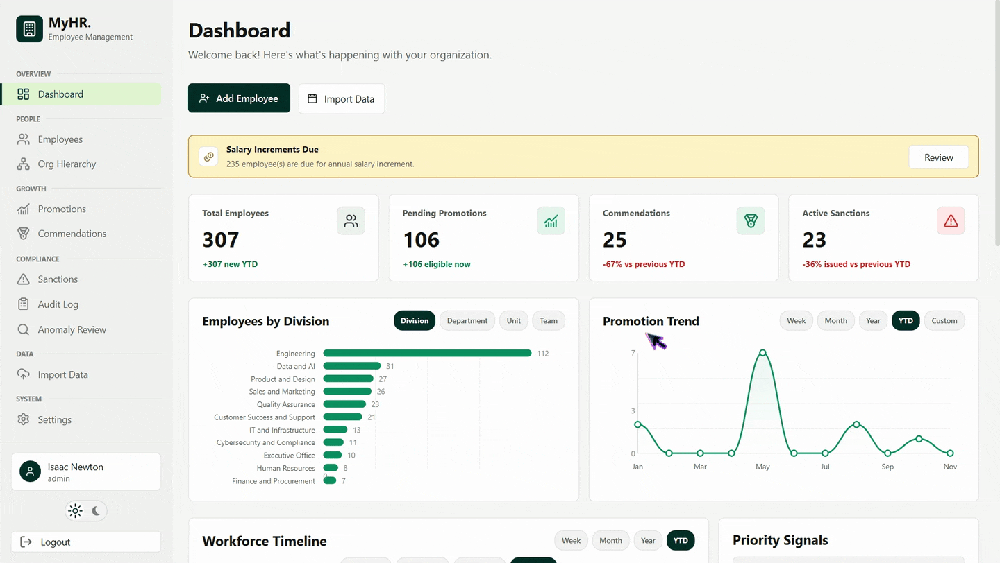
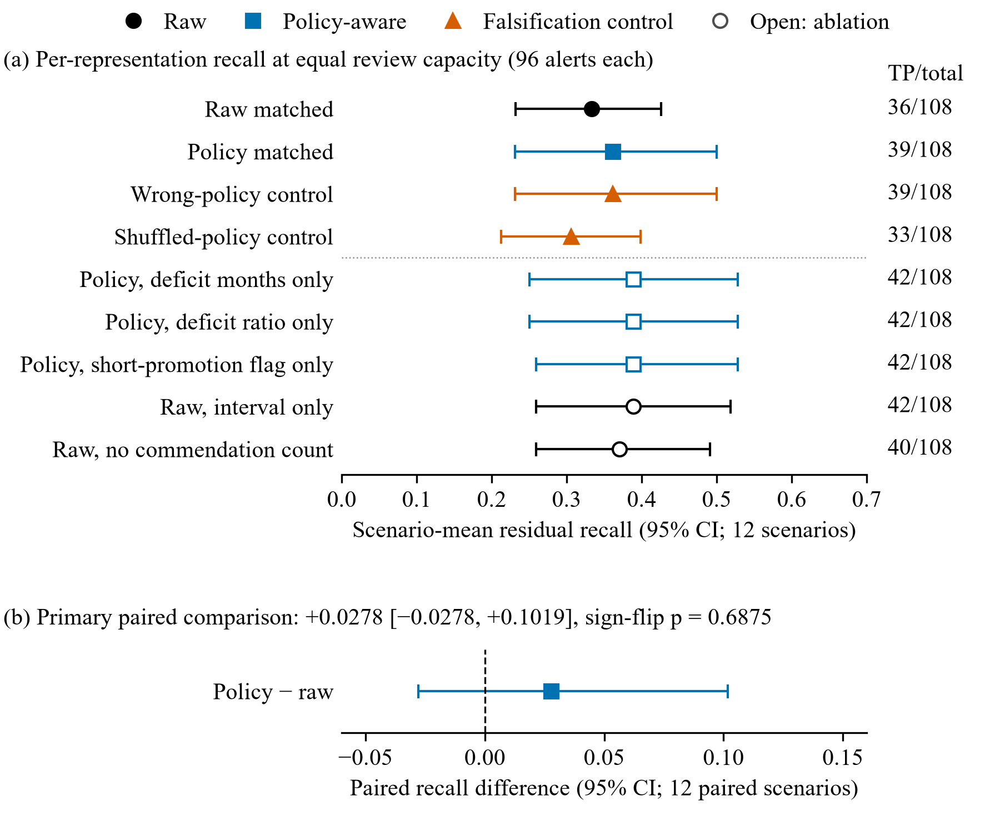
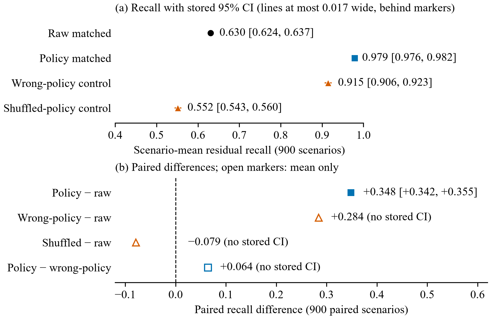
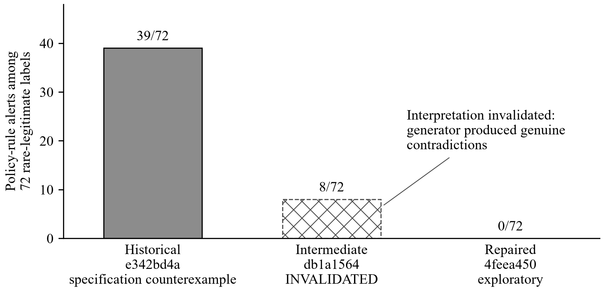
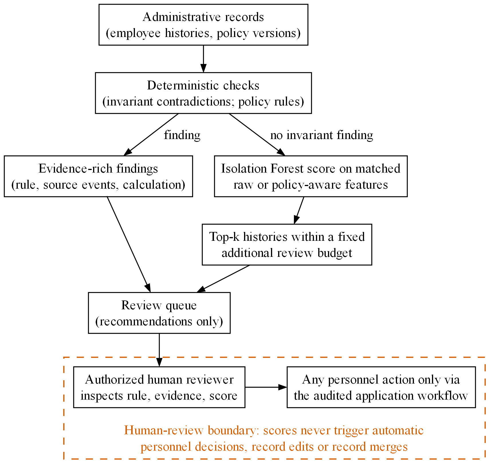
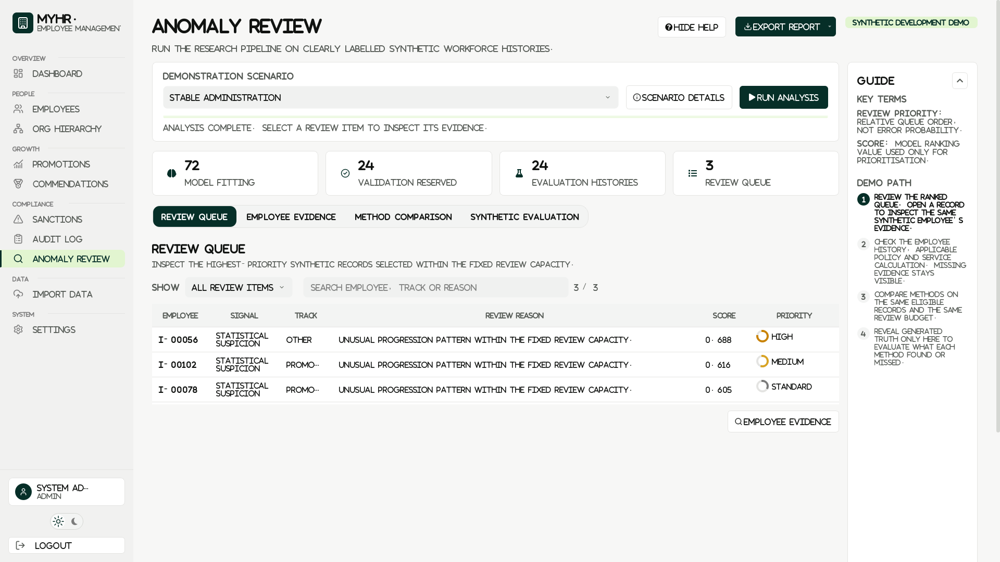
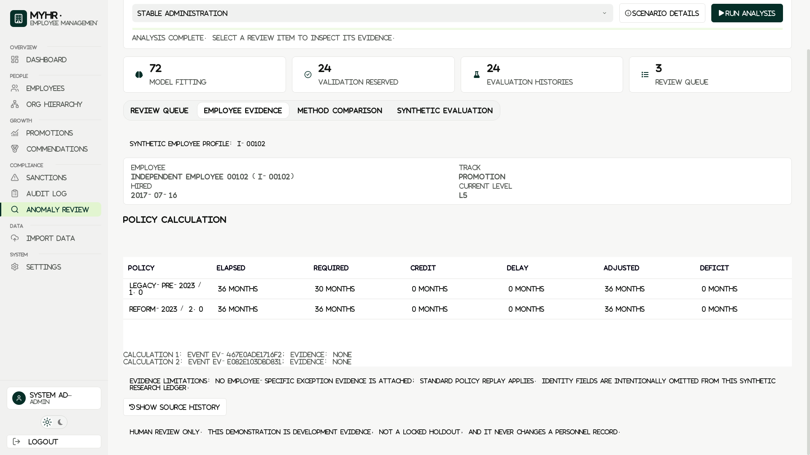
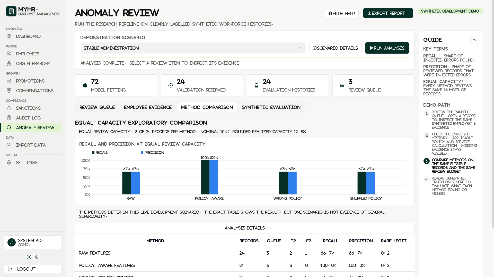
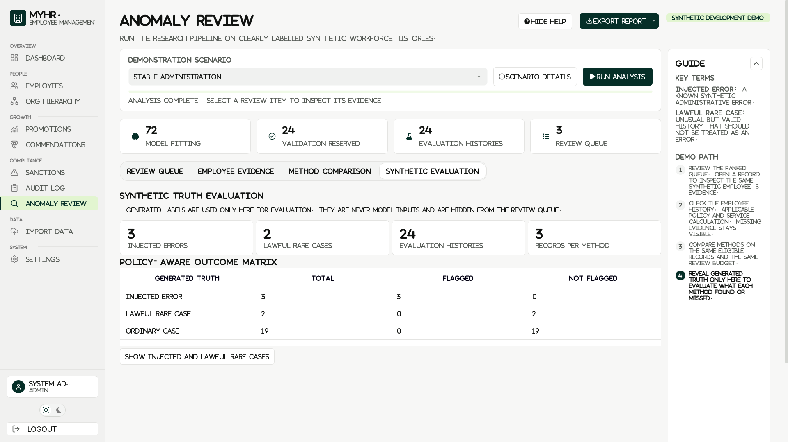

# MyHR: Policy-Aware Machine Learning for Anomaly Detection in Workforce Progression

BME VIK TDK 2026 research project by Muhammad Ibrahim Shoeb. Supervisor: Dr. Husam Al-Magsoosi.
Budapest University of Technology and Economics, Faculty of Electrical Engineering and Informatics.

MyHR is an offline HR desktop application (Python, PySide6, SQLite). This branch (`research`) also contains
the research pipeline that asks one question: **does explicit workforce-progression policy context help rank
administrative errors for human review better than raw administrative features, without raising false alerts on
unusual but lawful histories?**

## Working implementation

The research pipeline runs inside the MyHR desktop application, not only as scripts. Open **Anomaly Review** in the
sidebar and select **Run analysis**. Everything below is produced by the same shared code that the experiments use.



*28-second recording of the real application with synthetic data ([MP4](docs/media/demo/myhr_demo.mp4)).*

| What you can check | Where in the application |
| --- | --- |
| Anomaly detection running in the app | **Anomaly Review**, then **Run analysis**; results appear in the **Review Queue** |
| Why an item was flagged (drill-down) | **Employee Evidence**: the same employee's source events and the policy calculation (elapsed service, credit, delay, deficit) |
| Does policy context help? | **Method Comparison**: raw, policy-aware, wrong-policy and shuffled-policy features at the same review capacity, as charts and an exact table |
| Ground truth for the synthetic data | **Synthetic Evaluation**: injected errors, lawful rare cases, per-method outcomes |
| Export | CSV and PDF report from the same result |

Steps to run it are in [Run it](#run-it). The pipeline never changes employee records: every alert is a recommendation
for a human reviewer.

## Result

**The policy-aware advantage is not demonstrated.** In the audited development artifact the gain over raw features is
small and its confidence interval includes zero. A deliberately wrong policy performs about as well as the correct one,
so the gain cannot be attributed to policy knowledge. All results are development evidence on synthetic data. The
protocol is a draft and the final holdout has not been generated or accessed.

## Read the paper

**[Final paper (PDF)](docs/paper/MyHR_Policy_Aware_Machine_Learning_for_Anomaly_Detection_in_Workforce_Progression.pdf)**,
39 pages, of which 31 are main text. The Markdown source is [docs/TDK_PAPER_DRAFT.md](docs/TDK_PAPER_DRAFT.md).

## Main findings

All numbers below are copied from the audited artifacts and appear in the paper (Sections 6.7 and 6.8).

**1. Equal review capacity, 12 development scenarios** (artifact `4feea4508de1bb05`: 864 test histories,
108 injected errors, 96 alerts reviewed per method).

| Method | True positives | False positives | Recall |
| --- | ---: | ---: | ---: |
| Raw features | 36 | 60 | 33.3% |
| Policy-aware features | 39 | 57 | 36.1% |
| Wrong-policy control | 39 | 57 | 36.1% |
| Shuffled-policy control | 33 | 63 | 30.6% |

Policy-aware minus raw recall is **+0.0278** (95% interval −0.0278 to +0.1019, sign-flip p = 0.6875). The wrong-policy
control selected exactly the same alerts as the policy-aware model.



**2. Larger diagnostic, 900 scenarios** (artifact `8f1494e4abf2d268`). Wrong-policy features reproduced about 82% of
the apparent policy gain, so the large raw-to-policy difference is mostly an effect of the added columns, not of correct
policy knowledge. The audit of this artifact's 8,019,000 prediction rows is not finished, so this is a diagnostic only.

| Comparison (mean recall difference) | Value |
| --- | ---: |
| Policy-aware minus raw | +0.348 (95% interval 0.342 to 0.355) |
| Wrong-policy minus raw | +0.284 |
| Shuffled-policy minus raw | −0.079 |
| Policy-aware minus wrong-policy | +0.064 |



**3. Failures that were found, kept and fixed.**

- A first design filtered out every history with a policy finding, which set all three policy features to zero. That
  comparison could not test the hypothesis.
- A count of 39 of 72 rare-legitimate histories flagged by the rules was a constructed specification counterexample,
  not a prevalence estimate. A later 8 of 72 reading was invalidated because the generator had created genuine
  contradictions. The repaired artifact flags 0 of 72, but 24 of those labels have no stored employee-specific
  entitlement evidence, so 0/72 is not a validated false-positive rate.



**4. Deterministic rules** found 63 of 108 errors with no false positives (45 missed) on the 12-scenario artifact.

## System overview



Deterministic checks explain explicit contradictions, Isolation Forest ranks the remaining histories, and a human
reviews every alert. Scores never change personnel records. The in-app **Anomaly Review** page runs this pipeline on
synthetic histories: review queue, employee evidence with the policy arithmetic, a comparison of the four feature
representations at equal capacity, and the generated truth on a separate tab.

| Review queue | Employee evidence |
| --- | --- |
|  |  |
| **Method comparison** | **Synthetic evaluation** |
|  |  |

## Limitations

- Synthetic data only. Realism has not been reviewed by humans.
- The policy-aware advantage is not demonstrated, and the 12-scenario interval does not show equivalence either.
- Not reported in the paper: numerical results for the IQR and z-score baselines, the duplicate-detection comparison
  and runtime. These parts are implemented in the code.
- The optional user study of explanations was not conducted.
- The independent citation re-audit is pending, and one reference (Krippendorff) is still unverified.

## Future work

1. Add a raw control with extra non-policy columns of comparable variance, to separate the effect of the added
   columns from policy knowledge.
2. Run the blinded realism review with two independent human reviewers.
3. Freeze the protocol, then run the locked holdout once, after supervisor approval.
4. Use a balanced scenario matrix with 30 seeds per cell and finish the audit of the 900-scenario artifact.
5. Report the baselines, duplicate-detection benchmark and runtime.
6. Study how explanations affect reviewers, then validate on a real organisation with its own policies.

## For the reviewer: where to find things

| Need | Location |
| --- | --- |
| Final paper | [PDF](docs/paper/MyHR_Policy_Aware_Machine_Learning_for_Anomaly_Detection_in_Workforce_Progression.pdf) |
| All figures and the data behind them | [docs/figures/](docs/figures/README.md), [FIGURE_MANIFEST.json](docs/figures/FIGURE_MANIFEST.json) |
| Result tables (LaTeX) | [docs/tables/](docs/tables/README.md) |
| Experiment protocol (draft) | [docs/TDK_EXPERIMENT_PROTOCOL.md](docs/TDK_EXPERIMENT_PROTOCOL.md) |
| Research handover and decisions | [docs/RESEARCH_HANDOVER.md](docs/RESEARCH_HANDOVER.md), [roadmap](docs/TDK_AUTONOMOUS_RESEARCH_ROADMAP.md) |
| Audits | [citations](docs/TDK_CITATION_AUDIT_2026-11-01.md), [second external audit](docs/TDK_SECOND_EXTERNAL_AUDIT_2026-10-30.md) |
| References | [docs/TDK_REFERENCES.bib](docs/TDK_REFERENCES.bib) |
| Anomaly code | [src/services/anomaly_detection/](src/services/anomaly_detection/), [src/ui/pages/anomaly_review.py](src/ui/pages/anomaly_review.py) |
| Tag of the submitted version | `tdk-2026-submission` |

## Run it

```powershell
pip install -r requirements.txt -r requirements-research.txt
python scripts/seed_demo_company.py      # optional: synthetic demo company
python main.py
```

Sign in as `admin` / `admin123` (local demo database only). Then open **Employees**, search `Peter Ahmed`, and open
the **Performance** tab. Then open **Anomaly Review**, choose a scenario and select **Run analysis**.

Checks and reproduction, from the repository root:

```powershell
python -m unittest discover -s tests
python scripts/verify_anomaly_demo.py
python scripts/verify_tdk_citations.py --require-local-artifact
python scripts/build_tdk_figures.py
```

The research artifacts in `research_outputs/` are write-once and not stored in Git because of their size (up to 1.9 GB).
Their identifiers, source revisions and checksums are listed in the paper and the figure manifest. There is no holdout
command, and the protocol runner refuses a holdout run until a human-approved freeze.

## The application

MyHR manages employee records and profiles, performance reviews, an organization hierarchy, promotion races (live from
source records), annual salary increments, commendations and sanctions, an audit log, CSV and XLSX import, exports and
yearly PDF reports. It has light and dark themes and English, Hungarian and Arabic interfaces. Settings, user
management, export and backup are admin only. New dropdowns must use `AppSelect` (see `docs/UI_RULES.md`).

| Branch | Purpose |
| --- | --- |
| `master` | Project Laboratory submission |
| `thesis` | Verified working application |
| `research` | Research pipeline, application and Anomaly Review (this README) |

Stack: Python 3.12+, PySide6 (Qt 6), SQLite with SQLAlchemy 2.0, scikit-learn, pandas, Matplotlib, Graphviz.
Academic project 2025 to 2026. No open-source licence has been chosen yet ([docs/LICENSING_AND_IP.md](docs/LICENSING_AND_IP.md)).
Citation metadata: [CITATION.cff](CITATION.cff).
